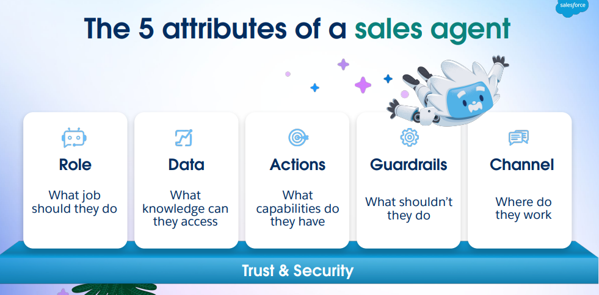
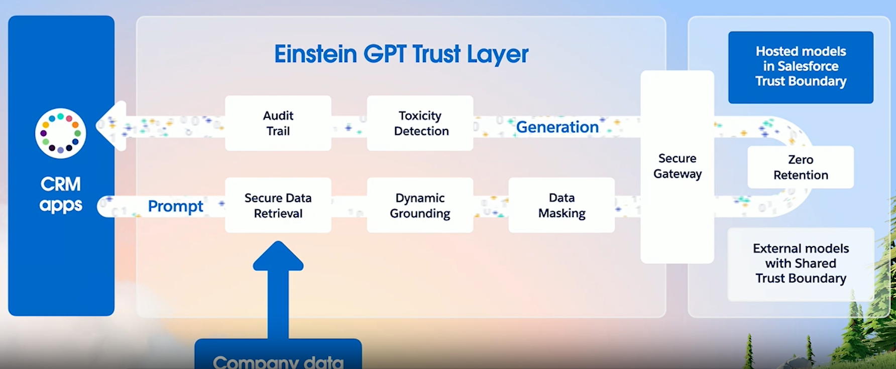
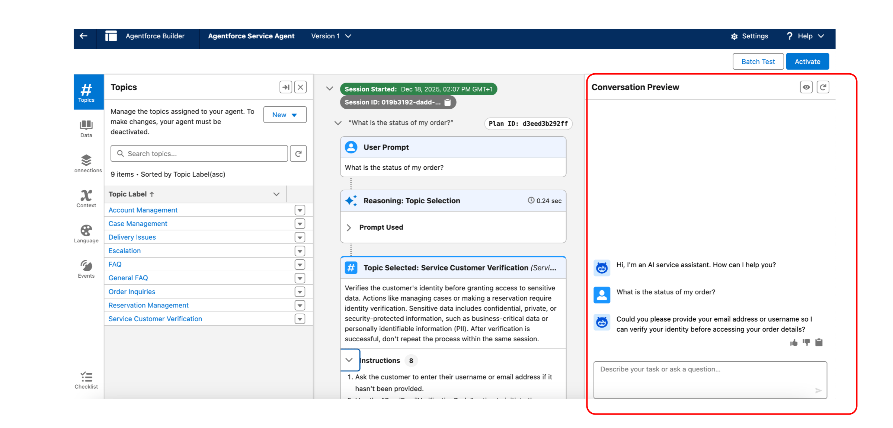
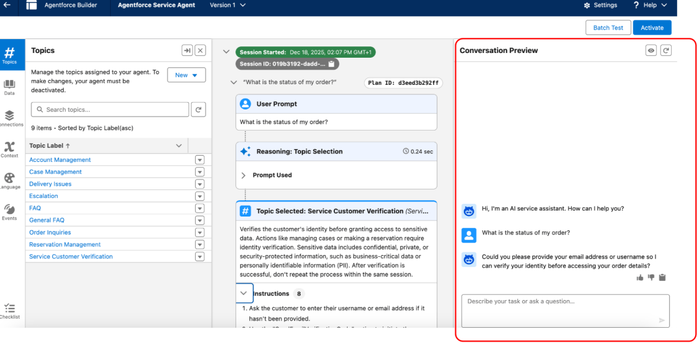

# Agentforce 8%

The first chapter of this documentation is abount Agentforce, the newest technology of Salesforce that is interacting with a contect on which is changing faster every year.

## Fundamentals

A simple resume from the website, What are the 5 attributes of Sales Agent?

{width="841"}

How do I trust Generative AI?

Einstein GPT Trust Layer\

{width="907"}

### PPI/Data Masking

An administrator wants to ensure that when Agentforce generates email drafts, sensitive customer credit card numbers stored in the case description are never visible to an external Large Language Model (LLM) provider. Which Einstein Trust Layer capability directly prevents this sensitive data from being shared with the LLM?

- PPI/Data Masking

***The PII/Data Masking feature of the Einstein Trust Layer is responsible for identifying sensitive information, such as credit card numbers, email addresses, or social security numbers, within a prompt and replacing it with generic placeholder text (e.g., [CREDIT_CARD_NUMBER]) before the request is sent to the external LLM. This ensures that the third-party model never receives or processes the actual sensitive data, keeping it securely inside the Salesforce boundary.***

*Zero Data Retention is a policy agreement that ensures an external LLM provider does not store or train their models on the data sent to them, but it does not prevent the data from being sent in the first place. Prompt Defense is designed to detect and block "jailbreaking" attempts or malicious prompts that try to bypass safety controls, not to hide data. Toxic Language Detection scans the AI's output to prevent the generation of harmful or offensive content, but it does not protect sensitive input data from reaching the model.*

<https://www.salesforce.com/artificial-intelligence/trusted-ai/>

<https://help.salesforce.com/s/articleView?language=en_US&id=ai.generative_ai_trust_layer.htm&type=5>

Cosmic Bank's compliance team asks the admin whether sensitive customer data typed into an Agentforce conversation is masked before being sent to the underlying large language model, the same way it would be for other generative AI features like Einstein Work Summaries. How should the admin respond?

- Pattern-based and field-based data masking for LLMs is disabled for agents, so this masking behaviour soes not apply to Agentforce conversations the same way.

***Pattern-based and field-based data masking for LLMs is disabled for agents for better performance, which is a key distinction admins must understand when evaluating data governance for Agentforce versus other Einstein generative AI features such as Einstein Service Replies or Work Summaries, where masking can be configured.***

*While data masking can help protect sensitive information from exposure to the LLMs, in some cases, it can affect the accuracy and relevance of the agent’s response.*

*Claiming that all agent conversations are automatically masked the same way as other generative AI features is factually incorrect for agents specifically. Claiming masking is turned off everywhere except Agentforce reverses the actual behavior. Attributing masking to the end user's browser is also incorrect, since data masking is a server-side Einstein Trust Layer capability, not a browser setting.*

<https://help.salesforce.com/s/articleView?id=ai.copilot_trust.htm&type=5>

### Zero-data retention policy

The security team at Cosmic Bank is reviewing Agentforce before rollout. The team needs assurance that the external model provider will not keep the prompts and responses sent to its large language model and will not use them to train its models. Which Einstein Trust Layer capability addresses this requirement?

- Zero-data retention policy

***Under the zero-data retention policy, third-party LLM providers don’t retain data sent to their models. No data is used for model training or product improvements by those providers. Salesforce enforces this policy with its external model providers.***

*Data masking detects sensitive data and replaces it before the prompt is sent to the model. It limits what the model sees but doesn’t govern whether the provider keeps or trains on what it receives.*

*The audit trail logs prompts, responses, and trust signals in Data 360 so they can be reviewed. It supports oversight inside Salesforce and doesn’t control what the external provider does with the data.*

*Toxicity scoring rates generated content for harmful or inappropriate language and logs the scores in the audit trail. It doesn’t govern whether the external provider keeps or trains on the data it receives*

### OWD

A service agent asks Agentforce to summarize a high-priority case managed by a different regional team. Although the administrator confirms the case exists in Salesforce, Agentforce responds that it cannot find the record. The service agent also cannot find this case when performing a manual global search. What is the most likely reason for this behavior?

- The Organization-Wide Default sharing setting for Cases is set to Private, and no sharing rule grants access to the agent.

***Agentforce operates strictly within the boundaries of the user’s permissions and visibility settings. It creates a plan and executes actions using the requesting user's security access. If the organization's sharing model is set to Private and no sharing rules or manual sharing mechanisms grant the user access to that specific record, the AI agent effectively "cannot see" it and will report that the information is unavailable.***

*The Einstein Trust Layer is responsible for masking sensitive data and enforcing safety policies, but it does not control record-level visibility or hide the existence of records based on ownership. Granting "View All Data" is a security risk and is not required for standard agent operations, as the agent simply needs the same access as the user it is assisting. While search indexing issues can occur, the scenario describes a classic access control issue where the user (and therefore the AI agent) lacks visibility due to restrictive sharing settings.*

### Einstein Trust Layer's

Cosmic Telecom wants to understand what protects the org from a customer trying to manipulate the agent into ignoring its instructions or revealing internal system prompts. Which Salesforce feature is primarily responsible for this kind of protection?

- The Einstein Trust Layer's prompt injection and toxicity detection.

The Einstein Trust Layer is the secure AI architecture natively built into Salesforce that Agentforce relies on; it includes content-safety protections such as prompt injection detection and toxicity detection designed to defend against attempts to manipulate the model or extract unintended output. Field-level security governs access to record data, not conversational manipulation of the model, so it doesn't address this concern. A page layout is a UI configuration and has no bearing on AI model security. Organization-wide default sharing settings control record visibility between users, not protection against prompt manipulation.

<https://help.salesforce.com/s/articleView?id=ai.copilot_trust.htm&type=5>

### Agentforce Testing Center

Cosmic Travel wants to test its agent against a large, diverse set of realistic customer questions before a major release, rather than manually typing each test conversation one at a time. Which tool should the admin use?

- Agentforce Testing Center, which supports batch testing.

***Agentforce Testing Center is purpose-built for scaled validation: it supports batch testing so admins can run large sets of test cases (including AI-assisted generation of test data) and review results systematically, dramatically reducing testing time compared to one-off manual runs.***

*Using Conversation Preview repeatedly for each test case is well suited to quick, individual checks during active building but is not designed for large-scale batch validation. The Salesforce mobile app's offline briefing feature is unrelated to agent testing. The Setup Audit Trail records configuration changes, not conversational test results.*

<https://help.salesforce.com/s/articleView?id=ai.agent_testing_center.htm&language=en_US&type=5>

## Agent Types and Considerations

+----------------------------------------+-------------------------------------------------------------------------------------------------------------------------------------------------------------------------------------------------------------------------------------------------------------------------------------------------------------------------+------------------------------------------------------------------------------------------------------------------------------------------------------------------------------------------------------------------------------------------------------------------------------------------------------------------------------------------------------------------------------------------------------------------------------------------------------------------------------------------------------------------------------------------------------------------------------------------------------------------------------------------------------------------------------------------------------------------------------------------------------------------------------------------------------+-----------------------------------------------------------------------------------------------------------------------------------------------------------------------------------------------------------------------------------------------------------------------------------------------------------------------------------------------------------------------------------------------------------------------------------------------------------------------------------+
| **Agent Type**                         | **What it Does**                                                                                                                                                                                                                                                                                                        | **Required Editions**                                                                                                                                                                                                                                                                                                                                                                                                                                                                                                                                                                                                                                                                                                                                                                                | **Required Permissions**                                                                                                                                                                                                                                                                                                                                                                                                                                                          |
+:=======================================+:========================================================================================================================================================================================================================================================================================================================+:=====================================================================================================================================================================================================================================================================================================================================================================================================================================================================================================================================================================================================================================================================================================================================================================================================+:==================================================================================================================================================================================================================================================================================================================================================================================================================================================================================+
| Employee Agent                         | Assists employees by providing access to company knowledge, performing tasks, and streamlining workflows across departments.                                                                                                                                                                                            | Available in Enterprise, Performance, Unlimited, and Developer Editions with Foundations or Agentforce 1 Editions. Access to some standard agent actions requires[additional add-on licenses](https://www.salesforce.com/agentforce/pricing/).                                                                                                                                                                                                                                                                                                                                                                                                                                                                                                                                                       | To create and manage Agentforce Employee Agent: Manage AI Agents                                                                                                                                                                                                                                                                                                                                                                                                                  |
|                                        |                                                                                                                                                                                                                                                                                                                         |                                                                                                                                                                                                                                                                                                                                                                                                                                                                                                                                                                                                                                                                                                                                                                                                      |                                                                                                                                                                                                                                                                                                                                                                                                                                                                                   |
|                                        | Before getting started, review [Considerations for Agentforce Employee Agent](https://help.salesforce.com/s/articleView?id=ai.agent_employee_agent_considerations.htm&language=en_US&type=5 "Before setting up an Agentforce Employee agent, keep these considerations in mind.").                                      | Agentforce Employee agents require [Flex Credits](https://help.salesforce.com/s/articleView?id=ai.usage_flex_credits.htm&language=en_US&type=5 "Using Agentforce and embedded AI features can impact credit consumption.").                                                                                                                                                                                                                                                                                                                                                                                                                                                                                                                                                                          | To use Agentforce Employee Agent, see [Manage Employee Agent Access](https://help.salesforce.com/s/articleView?id=ai.agent_manage_aea_access.htm&language=en_US&type=5 "Control user access to specific Agentforce Employee agents with permission sets or profiles. In Agentforce Builder, use the Agent Access page. In the legacy Agentforce Builder, use the Agent Access tab.").                                                                                             |
+----------------------------------------+-------------------------------------------------------------------------------------------------------------------------------------------------------------------------------------------------------------------------------------------------------------------------------------------------------------------------+------------------------------------------------------------------------------------------------------------------------------------------------------------------------------------------------------------------------------------------------------------------------------------------------------------------------------------------------------------------------------------------------------------------------------------------------------------------------------------------------------------------------------------------------------------------------------------------------------------------------------------------------------------------------------------------------------------------------------------------------------------------------------------------------------+-----------------------------------------------------------------------------------------------------------------------------------------------------------------------------------------------------------------------------------------------------------------------------------------------------------------------------------------------------------------------------------------------------------------------------------------------------------------------------------+
| Lead Nurturing (formerly known as SDR) | Intelligently engages leads with personalized content, answers common questions, and schedules meetings.                                                                                                                                                                                                                | Available in Enterprise, Performance, Unlimited, and Developer Editions with Foundations or Agentforce 1 Editions                                                                                                                                                                                                                                                                                                                                                                                                                                                                                                                                                                                                                                                                                    | See [SDR Agent Permission Sets](https://help.salesforce.com/s/articleView?id=sales.sales_agent_sdr_permissions.htm&language=en_US&type=5).                                                                                                                                                                                                                                                                                                                                        |
|                                        |                                                                                                                                                                                                                                                                                                                         |                                                                                                                                                                                                                                                                                                                                                                                                                                                                                                                                                                                                                                                                                                                                                                                                      |                                                                                                                                                                                                                                                                                                                                                                                                                                                                                   |
|                                        | Before getting started, review [Considerations for Using Agentforce Lead Nurturing](https://help.salesforce.com/s/articleView?id=sales.sales_agent_sdr_considerations.htm&language=en_US&type=5).                                                                                                                       |                                                                                                                                                                                                                                                                                                                                                                                                                                                                                                                                                                                                                                                                                                                                                                                                      |                                                                                                                                                                                                                                                                                                                                                                                                                                                                                   |
+----------------------------------------+-------------------------------------------------------------------------------------------------------------------------------------------------------------------------------------------------------------------------------------------------------------------------------------------------------------------------+------------------------------------------------------------------------------------------------------------------------------------------------------------------------------------------------------------------------------------------------------------------------------------------------------------------------------------------------------------------------------------------------------------------------------------------------------------------------------------------------------------------------------------------------------------------------------------------------------------------------------------------------------------------------------------------------------------------------------------------------------------------------------------------------------+-----------------------------------------------------------------------------------------------------------------------------------------------------------------------------------------------------------------------------------------------------------------------------------------------------------------------------------------------------------------------------------------------------------------------------------------------------------------------------------+
| Sales Coach                            | Intelligently gives reps personalized, actionable, and stage-specific feedback on their sales pitch or role-play session.                                                                                                                                                                                               | Available in Enterprise, Performance, Unlimited, and Developer Editions with Foundations or Agentforce 1 Editions                                                                                                                                                                                                                                                                                                                                                                                                                                                                                                                                                                                                                                                                                    | See [Agentforce Sales Coach Permissions](https://help.salesforce.com/s/articleView?id=sales.sales_agents_coach_permissions.htm&language=en_US&type=5).                                                                                                                                                                                                                                                                                                                            |
|                                        |                                                                                                                                                                                                                                                                                                                         |                                                                                                                                                                                                                                                                                                                                                                                                                                                                                                                                                                                                                                                                                                                                                                                                      |                                                                                                                                                                                                                                                                                                                                                                                                                                                                                   |
|                                        | Before getting started, review [Generative AI Considerations for Agentforce Sales Coach](https://help.salesforce.com/s/articleView?id=sales.sales_coach_agent_gen_ai_considerations.htm&language=en_US&type=5).                                                                                                         |                                                                                                                                                                                                                                                                                                                                                                                                                                                                                                                                                                                                                                                                                                                                                                                                      |                                                                                                                                                                                                                                                                                                                                                                                                                                                                                   |
+----------------------------------------+-------------------------------------------------------------------------------------------------------------------------------------------------------------------------------------------------------------------------------------------------------------------------------------------------------------------------+------------------------------------------------------------------------------------------------------------------------------------------------------------------------------------------------------------------------------------------------------------------------------------------------------------------------------------------------------------------------------------------------------------------------------------------------------------------------------------------------------------------------------------------------------------------------------------------------------------------------------------------------------------------------------------------------------------------------------------------------------------------------------------------------------+-----------------------------------------------------------------------------------------------------------------------------------------------------------------------------------------------------------------------------------------------------------------------------------------------------------------------------------------------------------------------------------------------------------------------------------------------------------------------------------+
| Service Agent                          | Intelligently supports your customers with common inquiries and escalates complex issues.                                                                                                                                                                                                                               | Available in Enterprise, Performance, Unlimited, and Developer Editions with Foundations or Agentforce 1 Editions. Access to some standard agent actions requires [additional add-on licenses](https://www.salesforce.com/agentforce/pricing/).                                                                                                                                                                                                                                                                                                                                                                                                                                                                                                                                                      | To create and manage Agentforce Service agents: Manage Agentforce Service Agents permission set                                                                                                                                                                                                                                                                                                                                                                                   |
|                                        |                                                                                                                                                                                                                                                                                                                         |                                                                                                                                                                                                                                                                                                                                                                                                                                                                                                                                                                                                                                                                                                                                                                                                      |                                                                                                                                                                                                                                                                                                                                                                                                                                                                                   |
|                                        | Before getting started, review [Considerations for Agentforce Service Agent](https://help.salesforce.com/s/articleView?id=ai.service_agent_considerations.htm&language=en_US&type=5 "To use Agentforce Service Agent, consider supported functionality, usage, limitations and allowances, limits, and other issues."). |                                                                                                                                                                                                                                                                                                                                                                                                                                                                                                                                                                                                                                                                                                                                                                                                      |                                                                                                                                                                                                                                                                                                                      |
|                                        |                                                                                                                                                                                                                                                                                                                         |                                                                                                                                                                                                                                                                                                                                                                                                                                                                                                                                                                                                                                                                                                                                                                                                      |                                                                                                                                                                                                                                                                                                                                                                                                                                                                                   |
|                                        |                                                                                                                                                                                                                                                                                                                         |                                                                                                                                                                                                                                                                                                                                                                                                                                                                                                                                                                                                                                                                                                                                                                                                      | Note This permission set contains the Manage AI Agents permission, which is required to access Agentforce Builder. Manage AI Agents grants org-wide management access to all agents, not just the agent type or template named in the permission set. Users with this permission can manage, activate, and deactivate agents, customize subagents and actions, and monitor agent activity. Assign this permission set only to users who require org-wide agent management access. |
|                                        |                                                                                                                                                                                                                                                                                                                         |                                                                                                                                                                                                                                                                                                                                                                                                                                                                                                                                                                                                                                                                                                                                                                                                      |                                                                                                                                                                                                                                                                                                                                                                                                                                                                                   |
|                                        |                                                                                                                                                                                                                                                                                                                         |                                                                                                                                                                                                                                                                                                                                                                                                                                                                                                                                                                                                                                                                                                                                                                                                      | To let the agent user securely access data and perform actions, see [Configure Service Agent Access](https://help.salesforce.com/s/articleView?id=ai.agent_user.htm&language=en_US&type=5 "Learn how Agentforce Service agents control data access. Set up an agent user for your Agentforce Service agent and assign permissions, so your agent has everything it needs to do its job.").                                                                                        |
+----------------------------------------+-------------------------------------------------------------------------------------------------------------------------------------------------------------------------------------------------------------------------------------------------------------------------------------------------------------------------+------------------------------------------------------------------------------------------------------------------------------------------------------------------------------------------------------------------------------------------------------------------------------------------------------------------------------------------------------------------------------------------------------------------------------------------------------------------------------------------------------------------------------------------------------------------------------------------------------------------------------------------------------------------------------------------------------------------------------------------------------------------------------------------------------+-----------------------------------------------------------------------------------------------------------------------------------------------------------------------------------------------------------------------------------------------------------------------------------------------------------------------------------------------------------------------------------------------------------------------------------------------------------------------------------+
| Service Assistant                      | Intelligently helps your service reps resolve cases faster with case summaries and step-by-step resolution guidance.                                                                                                                                                                                                    | Available in Enterprise, Performance, and Unlimited Editions with Foundations and the Agentforce for Service add-on or Agentforce 1 Service Edition                                                                                                                                                                                                                                                                                                                                                                                                                                                                                                                                                                                                                                                  | See [Permissions and Licensing for Service Assistant](https://help.salesforce.com/s/articleView?id=service.sp_permissions.htm&language=en_US&type=5).                                                                                                                                                                                                                                                                                                                             |
|                                        |                                                                                                                                                                                                                                                                                                                         |                                                                                                                                                                                                                                                                                                                                                                                                                                                                                                                                                                                                                                                                                                                                                                                                      |                                                                                                                                                                                                                                                                                                                                                                                                                                                                                   |
|                                        | Before getting started, review [Considerations for Service Assistant](https://help.salesforce.com/s/articleView?id=service.sp_considerations.htm&language=en_US&type=5).                                                                                                                                                |                                                                                                                                                                                                                                                                                                                                                                                                                                                                                                                                                                                                                                                                                                                                                                                                      |                                                                                                                                                                                                                                                                                                                                                                                                                                                                                   |
+----------------------------------------+-------------------------------------------------------------------------------------------------------------------------------------------------------------------------------------------------------------------------------------------------------------------------------------------------------------------------+------------------------------------------------------------------------------------------------------------------------------------------------------------------------------------------------------------------------------------------------------------------------------------------------------------------------------------------------------------------------------------------------------------------------------------------------------------------------------------------------------------------------------------------------------------------------------------------------------------------------------------------------------------------------------------------------------------------------------------------------------------------------------------------------------+-----------------------------------------------------------------------------------------------------------------------------------------------------------------------------------------------------------------------------------------------------------------------------------------------------------------------------------------------------------------------------------------------------------------------------------------------------------------------------------+
| Setup with Agentforce                  | Helps your Salesforce admins complete Setup tasks, such as managing users, troubleshooting issues, and customizing your org. The Setup agent is created automatically when you enable Setup with Agentforce and isn’t visible or able to be customized in Agentforce Builder.                                           | Available in: Enterprise, Performance, Unlimited, and Developer Editions with Foundations or Agentforce 1 Editions                                                                                                                                                                                                                                                                                                                                                                                                                                                                                                                                                                                                                                                                                   | To enable or use Setup with Agentforce: [See Grant Permissions to Use Setup with Agentforce](https://help.salesforce.com/s/articleView?id=xcloud.setup_agentforce_permissions.htm&language=en_US&type=5)                                                                                                                                                                                                                                                                          |
|                                        |                                                                                                                                                                                                                                                                                                                         |                                                                                                                                                                                                                                                                                                                                                                                                                                                                                                                                                                                                                                                                                                                                                                                                      |                                                                                                                                                                                                                                                                                                                                                                                                                                                                                   |
|                                        | Before getting started, review [Considerations for Setup with Agentforce](https://help.salesforce.com/s/articleView?id=xcloud.setup_agentforce_considerations.htm&language=en_US&type=5).                                                                                                                               |                                                                                                                                                                                                                                                                                                                                                                                                                                                                                                                                                                                                                                                                                                                                                                                                      |                                                                                                                                                                                                                                                                                                                                                                                                                                                                                   |
+----------------------------------------+-------------------------------------------------------------------------------------------------------------------------------------------------------------------------------------------------------------------------------------------------------------------------------------------------------------------------+------------------------------------------------------------------------------------------------------------------------------------------------------------------------------------------------------------------------------------------------------------------------------------------------------------------------------------------------------------------------------------------------------------------------------------------------------------------------------------------------------------------------------------------------------------------------------------------------------------------------------------------------------------------------------------------------------------------------------------------------------------------------------------------------------+-----------------------------------------------------------------------------------------------------------------------------------------------------------------------------------------------------------------------------------------------------------------------------------------------------------------------------------------------------------------------------------------------------------------------------------------------------------------------------------+
| Agentforce (Default) - (Retired)       | Helps your employees accomplish key business tasks in Salesforce.                                                                                                                                                                                                                                                       |                                                                                                                                                                                                                                                                                                                                                                                                                                                                                                                                                                                                                               | To create and manage Agentforce (Default): Manage AI Agents AND Manage Agentforce Default Agent OR Customize Application                                                                                                                                                                                                                                                                                                                                                          |
|                                        |                                                                                                                                                                                                                                                                                                                         |                                                                                                                                                                                                                                                                                                                                                                                                                                                                                                                                                                                                                                                                                                                                                                                                      |                                                                                                                                                                                                                                                                                                                                                                                                                                                                                   |
|                                        | Before getting started, review [Agentforce (Default) Considerations](https://help.salesforce.com/s/articleView?id=ai.agent_default_considerations.htm&language=en_US&type=5 "To use Agentforce (Default), consider supported functionality, usage, limits and allowances, and more.").                                  | Important Starting June 17, 2025, Agentforce (Default) will not include new features or improvements and isn’t available in new Salesforce environments. We recommend migrating to Agentforce Employee agent for continued enhancements and support. If you plan to transition to Agentforce Employee agent or make related license changes, complete the migration of your existing Agentforce (Default) agents in advance to avoid potential disruption in agent availability. If you can't complete the migration in advance, you can create new agents after the transition, which can involve some downtime. See [Migrate from Agentforce (Default) to Agentforce Employee Agent](https://help.salesforce.com/s/articleView?id=ai.migrate_agentforce_default_to_aea.htm&language=en_US&type=5). | To use Agentforce (Default), see [Give Users Access to Agentforce (Default)](https://help.salesforce.com/s/articleView?id=ai.copilot_setup_user_access.htm&language=en_US&type=5 "Give your employees access to the default Agentforce agent by assigning permissions to users.").                                                                                                                                                                                                |
+----------------------------------------+-------------------------------------------------------------------------------------------------------------------------------------------------------------------------------------------------------------------------------------------------------------------------------------------------------------------------+------------------------------------------------------------------------------------------------------------------------------------------------------------------------------------------------------------------------------------------------------------------------------------------------------------------------------------------------------------------------------------------------------------------------------------------------------------------------------------------------------------------------------------------------------------------------------------------------------------------------------------------------------------------------------------------------------------------------------------------------------------------------------------------------------+-----------------------------------------------------------------------------------------------------------------------------------------------------------------------------------------------------------------------------------------------------------------------------------------------------------------------------------------------------------------------------------------------------------------------------------------------------------------------------------+
| Agent for Setup - (Retired)            |                                                                                                                                                            | Available in Enterprise, Performance, Unlimited, and Developer Editions with Foundations or Agentforce 1 Editions                                                                                                                                                                                                                                                                                                                                                                                                                                                                                                                                                                                                                                                                                    |                                                                                                                                                                                                                                                                                                                                                                                                                                                                                   |
|                                        |                                                                                                                                                                                                                                                                                                                         |                                                                                                                                                                                                                                                                                                                                                                                                                                                                                                                                                                                                                                                                                                                                                                                                      |                                                                                                                                                                                                                                                                                                                                                                                                                                                                                   |
|                                        | Note Agent for Setup is no longer being updated and can’t be enabled in new orgs beginning April 2026. We recommend that you use Setup with Agentforce instead, which can help with many more administrative tasks and is automatically updated with new functionality.                                                 |                                                                                                                                                                                                                                                                                                                                                                                                                                                                                                                                                                                                                                                                                                                                                                                                      |                                                                                                                                                                                                                                                                                                                                                                                                                                                                                   |
|                                        |                                                                                                                                                                                                                                                                                                                         |                                                                                                                                                                                                                                                                                                                                                                                                                                                                                                                                                                                                                                                                                                                                                                                                      |                                                                                                                                                                                                                                                                                                                                                                                                                                                                                   |
|                                        | Helps your org admins with every day administration tasks, looks for answers in Salesforce Help, and more.                                                                                                                                                                                                              |                                                                                                                                                                                                                                                                                                                                                                                                                                                                                                                                                                                                                                                                                                                                                                                                      |                                                                                                                                                                                                                                                                                                                                                                                                                                                                                   |
|                                        |                                                                                                                                                                                                                                                                                                                         |                                                                                                                                                                                                                                                                                                                                                                                                                                                                                                                                                                                                                                                                                                                                                                                                      |                                                                                                                                                                                                                                                                                                                                                                                                                                                                                   |
|                                        | Before getting started, review [Agent for Setup Considerations](https://resources.docs.salesforce.com/rel1/doc/en-us/static/pdf/setup_agent_original.pdf).                                                                                                                                                              |                                                                                                                                                                                                                                                                                                                                                                                                                                                                                                                                                                                                                                                                                                                                                                                                      |                                                                                                                                                                                                                                                                                                                                                                                                                                                                                   |
+----------------------------------------+-------------------------------------------------------------------------------------------------------------------------------------------------------------------------------------------------------------------------------------------------------------------------------------------------------------------------+------------------------------------------------------------------------------------------------------------------------------------------------------------------------------------------------------------------------------------------------------------------------------------------------------------------------------------------------------------------------------------------------------------------------------------------------------------------------------------------------------------------------------------------------------------------------------------------------------------------------------------------------------------------------------------------------------------------------------------------------------------------------------------------------------+-----------------------------------------------------------------------------------------------------------------------------------------------------------------------------------------------------------------------------------------------------------------------------------------------------------------------------------------------------------------------------------------------------------------------------------------------------------------------------------+

<https://help.salesforce.com/s/articleView?id=ai.agent_setup_explore_types.htm&type=5>

### Agentforce Employee Agent

An HR manager at Cosmic Kicks wants to deploy an AI agent to assist internal staff. The goal is to allow employees to ask questions about company benefits, retrieve their remaining time-off balance, and submit IT help desk tickets using natural language. Which AI agent type is best suited for this internal productivity scenario?

- Agentforce Employee Agent

***The Agentforce Employee Agent is specifically designed to support internal employees by integrating with enterprise systems to answer questions and automate administrative tasks. Unlike customer-facing agents, the Employee Agent operates as a teammate in internal channels (like Slack or Salesforce) to assist with HR inquiries, IT tickets, and general productivity workflows.***

*The Agentforce Service Agent is designed for external customer support scenarios, such as resolving cases and inquiries for clients, rather than internal employee productivity. The Agentforce Sales Coach is tailored for role-playing and training sales representatives, not for general HR or IT assistance. The Agentforce SDR is built for outbound sales development and lead qualification, making it unsuitable for internal administrative use cases.*

<https://help.salesforce.com/s/articleView?id=ai.agent_setup_explore_types.htm&type=5>

Cosmic Travel Group plans to launch a service agent that answers general customer questions. During planning, the consultant finds that many knowledge articles have inconsistent formatting, outdated details, and conflicting information. The articles for the company’s new guided tours offering were updated recently and are well structured. What should the consultant recommend?

- Start with a FAQ use case for guided tours while the general articles are improved.

***Agents need trustworthy, high-quality data to perform well, so the first use case should be one that the existing data can support. Starting with the guided tours FAQ lets the company deliver value with ready data while it cleans up the rest of the knowledge base. The results can then guide those improvements.***

*Refining instructions after launch doesn’t fix the underlying problem. An agent grounded in outdated and conflicting articles gives unreliable answers, however its instructions are written.*

*When data requirements can’t be met, the guidance is to reduce the scope or make the agent less autonomous, not more. More autonomy over weak data increases risk.*

*Adding another source doesn’t fix the outdated and conflicting articles that the agent would still draw on. The first use case should be one that the existing data can already support.*

<https://trailhead.salesforce.com/content/learn/modules/agentforce-agent-planning/identify-the-agent-use-case>

## Core Components

### Actions Instructions

CosmicTech Solutions is implementing custom agent actions to enhance its customer service processes. The development team needs to ensure that each action is correctly configured and functions as expected. Which core component of a custom agent action should the development team review during configuration?

- Action Instructions

***Instructions guide the agent in deciding how to use the actions within a topic across different use cases. They define what the action does and when it's used. Ensuring that the action instructions are properly configured is essential for making sure the agent performs tasks as expected and meets the desired outcomes.***

*Context variables, classification descriptions, and language settings are important, but do not directly define the core functionality or behavior of the action.*

<https://help.salesforce.com/s/articleView?id=ai.copilot_actions_instructions.htm&type=5>

### AI Sales Agents

Sales Agents:

$$\text{AI Sales Agents}_{} \to
\text{Agent Type}_{🤖} = \begin{cases}
\text{SDR Agent}& \text{  , Sales Development Representative}\\
\\
\text{Sales Coach} & \text{   , Situacion 2}\\
\\
\end{cases}$$

$$\text{AI Sales Agents}_{} \to
\text{Agent Type}_{} = \begin{cases}
\text{Prospecting}& \text{  , Situacion 1}\\
\\
\text{Agentforce Engagement} & \text{   , Situacion 2}\\
\\
\text{Sales Management} & \text{   , Situacion 3}\\
\\
\text{Sales Coaching} & \text{   , Situacion 4}\\
\\
\end{cases}$$

### Conversation Preview

Cosmic Solutions is building an Agentforce agent to answer customer questions about order status. During development, the admin wants to quickly test a few sample utterances and see which topics and actions the agent selects for each request before creating automated tests.\
Which Agentforce builder tool can be used in this scenario?

- Conversation Preview

***In this scenario, the admin needs to interact with the agent in real time to observe how topics and actions are selected for specific utterances. The Conversation Preview panel in Agentforce Builder allows for manual testing during development, providing immediate feedback on the agent’s behavior and decision-making.***

*Agentforce Testing Center is designed for batch testing large volumes of utterances and is better suited for automated, large-scale validation. Enhanced Event Logs allow admins to review recorded conversation events after interactions occur, but they do not provide real-time testing during development.\
Testing Preview is not an actual Agentforce tool and does not exist.*



Cosmic Media's admin has updated several instructions in an existing Topic and wants to verify the agent responds correctly before rolling the change out to all users. What is the most appropriate tool to use directly within Agent Builder for this quick validation?

- Conversation Preview, to test the agent's responses interactively before publishing changes.

***Agent Builder provides a Conversation Preview panel that lets admins interact with the agent in real time to test how it responds to updated Topics, instructions, or actions before those changes go live. This is the light, in-context testing referenced as part of an admin's day-to-day responsibility for maintaining agents.***

*The Setup Audit Trail tracks configuration changes made by users in the org, not conversational agent behavior, so it doesn't serve this purpose. Object Manager is used to manage schema and fields, not to test agent responses. Report Builder is used to build reports on Salesforce data, not to validate an agent's conversational behavior.*

### Topic

Cosmic Shoes' admin is building a new agent in Agent Builder and needs to define what the agent is allowed to discuss and do within a specific area of the business, such as order status inquiries. Which agent building block should the admin configure first for this purpose?

- A Topic

***A Topic (subagent) is the foundational building block in Agent Builder that scopes what an agent can understand and act on for a given subject area; each Topic includes a description, scope, instructions, and the actions assigned to it.***

*A permission set controls user access to the agent itself, not conversational scope, so it doesn't serve this purpose. A validation rule enforces data integrity on records and is unrelated to agent conversation boundaries. A page layout controls how fields display on a record in the UI and has no effect on what an agent is scoped to discuss or do.*

<https://help.salesforce.com/s/articleView?language=en_US&id=ai.copilot_topics.htm&type=5>

Cosmic Retail's admin notices that the agent frequently invokes the wrong action within a Topic that has many available actions. According to Agentforce best practices, what is the most effective way to help the reasoning engine choose the correct action?

- Write clear, specific descriptions for each action and its inputs/outputs so the reasoning engine can match user intent accurately.

***The reasoning engine relies heavily on the natural-language descriptions of actions, their inputs, and their outputs to decide when and how to invoke them; vague or overlapping descriptions are a leading cause of incorrect action selection.***

*Rebuilding the agent from scratch is unnecessary and doesn't address the root cause. Disabling every action but one would cripple the agent's intended functionality rather than fixing the selection logic. Renaming actions with generic labels like Action1 or Action2 would make it harder, not easier, for the reasoning engine to distinguish between them.*

<https://help.salesforce.com/s/articleView?id=003876294&type=1>

Cosmic Realty's admin is reviewing a Topic that currently has 30 actions assigned to it and is concerned about agent accuracy. What is the recommended approach?

- Keep the number of actions assigned to a single Topic reasonably scoped.

***Best practice guidance for building agents emphasizes keeping each Topic focused, with a scoped and manageable number of well-described actions, since an overloaded Topic increases ambiguity and reduces the reasoning engine's accuracy in selecting the right action for a given request.***

*Assigning every available action to every Topic, or combining all Topics into one, both increase ambiguity and scope creep rather than improving agent reliability, running counter to the scoped, well-defined Topic design Salesforce recommends. Removing the Topic's description field is also counterproductive, since that description is what the reasoning engine uses to match user intent to the right Topic in the first place; removing it would degrade accuracy further.*

### Data Cloud

Before an admin can turn on Einstein generative AI features to support Agentforce, what must already be provisioned and enabled in the org?

- Data Cloud

Data Cloud must be provisioned and enabled before turning on Einstein generative AI features, since it underlies essential functionality including the Trust Layer.

<https://help.salesforce.com/s/articleView?id=ai.generative_ai_enable.htm&type=5>

### PS & PSG

Cosmic Logistics has activated its first Agentforce agent, but several users report they cannot see or open the agent at all. The admin confirms the agent is active. What is the most likely cause?

- The users have not been assigned the required permissin set or permission set group

***Users need to be explicitly granted access to an agent through the appropriate permission set or permission set group before the agent becomes visible to them, even once the agent itself is active.***

*An overloaded Topic with too many actions might affect agent performance or accuracy, but it would not prevent the agent from appearing at all. Browser compatibility is not a documented cause of this specific access issue. The choice of flow versus Apex for an action has no bearing on whether users can see the agent itself.*

<https://help.salesforce.com/s/articleView?id=ai.copilot_setup_user_access.htm&type=5>

Cosmic Outfitters has a service agent with an action that runs a flow to update ‘Order’ records. In conversations, the action fails with an ‘Insufficient Privileges’ error. When the Salesforce administrator runs the same flow, it completes without errors. What should the administrator check first?

- Whether the agent user's permission set grants the needed object permissions on 'Order'.

***‘Insufficient Privileges’ errors usually point to missing permissions or incorrect object-level access. The agent user’s profile or permission set must include at least the minimum object permissions for each object the agent works with through flows. Running the flow as the agent user, instead of as an administrator, reveals permission issues that are otherwise easy to miss.***

*Subagent instructions affect whether and when the agent chooses an action. In this scenario, the agent already calls the action, and the failure happens when the flow runs.*

*Activating a new agent version doesn’t change the agent user’s access. The same permission error would occur in the new version.*

*Data masking hides sensitive data from the large language model. It doesn’t affect the agent user’s access to records, so it can’t cause or fix an ‘Insufficient Privileges’ error.*

### Apex Class

A developer at Cosmic Logistics builds a custom agent action that calls an Apex class to calculate delivery estimates. The class works when the developer tests it directly, but the action fails when the agent runs it. The agent user has the object permissions it needs. Which step resolves the issue while keeping the agent user’s access to a minimum?

- Give the agent user's profile access to the Apex class.

***For Apex, the guidance is to extend the security for any Apex class used by an agent to the agent user’s profile. Without access to the class, the action fails for the agent even though it runs for the developer.***

*The class runs correctly when the developer tests it directly, so the inputs aren’t the problem. The failure only happens when the agent user runs it, which points to access rather than instructions.*

*A data library provides content that grounds the agent’s answers, such as knowledge articles or uploaded files. It doesn’t give the agent user permission to run an Apex class.*

*‘Modify All Data’ grants broad access across the org and goes far beyond what the action needs. Agent users should have only the minimum level of access for the work the agent does.*

<https://trailhead.salesforce.com/content/learn/modules/agent-behavior-troubleshooting-in-agentforce/fix-configuration-and-data-issues>

### Human Escalation

Cosmic Software is deploying an Agentforce Service Agent to handle inbound customer chats and wants the agent to bring a human support rep into the conversation when a request is too complex for the agent to resolve. What capability supports this requirement?

- Human escalation, which allows the agent to hand off the conversation to a human agent.

***Agentforce agents, including Service Agent templates, support human escalation so that when a conversation exceeds the agent's defined scope or capability, it can be transferred to a human representative along with a conversation summary and key details to enable a smooth handoff.***

*A validation rule only controls whether a record can be saved and does not manage conversation handoff. A public group manages sharing visibility, not conversational escalation behavior. A required field affects record save behavior and has no role in routing a live conversation to a human.*

## Agent & Case

A sales manager asks Agentforce to summarize a specific confidential Opportunity record but receives a response indicating the information cannot be retrieved. An administrator verifies that the Opportunity exists and that other managers can successfully access it using Agentforce. What is the primary security mechanism causing this result?

- The AI agent inherits the requesting user's permission and strictly respects their sharing settings and field-level security.

***Agentforce operates by inheriting the access permissions of the user interacting with it. If the sales manager does not have the necessary object, field, or record-level access, such as sharing rules, to view the specific Opportunity record, the AI agent will be unable to retrieve or display that information.***

*Agentforce does not use a separate, overriding permission set for record access, nor does it require 'View All Data' to function. Agentforce strictly mirrors the user's access context. While the Einstein Trust Layer handles data masking to protect sensitive information during processing, the inability to retrieve a record entirely is caused by standard Salesforce sharing restrictions rather than Trust Layer redaction.*

<https://help.salesforce.com/s/articleView?language=en_US&id=platform.ls_agentforce_grant_user_object_field_access.htm&type=5>

### Escalated

A support agent attempts to use Agentforce to update the "Escalated" checkbox on a Case record during a conversation. The agent acknowledges the request but fails to complete the update, returning an error message indicating it cannot modify the record. An administrator confirms the Agentforce action is correctly configured and active. What is the most likely cause of this issue?\

- The support agent's profile lacks field-level secutiry Edit access for the 'Escalated' field.

***Agentforce operates by strictly inheriting the permissions of the user interacting with it. If the user does not have specific "Edit" access to a field via field-level security (FLS) in their profile or permission sets, the AI agent will be unable to modify that field, even if the Agent action itself is active and valid.***

*The Einstein Trust Layer focuses on data masking and safety policies (like preventing toxic output) rather than blocking standard field updates based on user permissions. Prompts provide instructions and context, but they do not control the underlying database permissions required to commit a change. "Customize Application" is a high-level administrative permission such that end users do not need it to perform standard record updates through the AI agent.*

<https://help.salesforce.com/s/articleView?id=platform.ls_agentforce_grant_user_object_field_access.htm&type=5>

Cosmic Care Solutions is evaluating ways to improve its customer support operations. The leadership team is deciding between implementing Einstein bots or adopting Salesforce Agentforce Service Agent. They want a solution that can independently handle customer conversations, take actions in Salesforce, and reduce the need for constant human intervention and scripted workflows.\
Which statement best describes the key difference between traditional bots and Agentforce Service Agent?

- Bots depend on predefined scripts and human assistance, while Agentforce Service Agent uses AI reasoning to autonomously manage realistic conversations and complete actions.

Traditional bots rely heavily on scripted conversations, predefined flows, and human support for handling more complex situations. In contrast, Agentforce Service Agent uses Salesforce’s AI reasoning engine to autonomously engage in realistic customer conversations, complete actions in Salesforce, and proactively support customer service goals with less manual setup and intervention.

<https://trailhead.salesforce.com/content/learn/modules/salesforce-messaging/enhance-a-basic-messaging-implementation>

### Poor Feet

Cosmic Wealth Partners wants an agent to approve or decline client requests for exceptions to its fee schedule. Today, senior advisors decide each request case by case. No written policy defines when an exception is allowed. The company’s records of past requests are complete and up to date. How should the consultant assess this use case?

- It's a poor fit for now, because the decision lack well-defined policies fot he agent to follow.

## Q&A {.unnumbered}

### Agentforce - Builder Tools {.unnumbered}

#### *Objective: Explain how to maintain, update, or install prompts and instructions in Agent Builder (light testing, conversation preview).* {.unnumbered}

1.  Cosmic Solutions is building an Agentforce agent to answer customer questions about order status. During development, the admin wants to quickly test a few sample utterances and see which topics and actions the agent selects for each request before creating automated tests.

**Which Agentforce builder tool can be used in this scenario?**

```{r echo=FALSE, results='asis'}
# 1. Cargamos la librería
library(webexercises)

# 2. Definimos las alternativas. La correcta siempre lleva 'answer ='
opciones_agentforce_1 <- c(
  "A. Agentforce Testing Center",
  answer = "B. Conversation Preview",
  "C. Enhanced Event Logs",
  "D. Testing Preview"
)

# 3. cat() inyecta el HTML directamente en la web
cat(longmcq(opciones_agentforce_1))

# Un pequeño salto de línea visual
cat("<br>\n\n")

# 4. Botón oculto con la explicación
cat(hide("Check"))
cat("**Correct Answer is: B. Conversation Preview.**\n\n")
cat("In this scenario, the admin needs to interact with the agent in real time to observe how topics and actions are selected for specific utterances. The Conversation Preview panel in Agentforce Builder allows for manual testing during development, providing immediate feedback on the agent’s behavior and decision-making.

Agentforce Testing Center is designed for batch testing large volumes of utterances and is better suited for automated, large-scale validation. Enhanced Event Logs allow admins to review recorded conversation events after interactions occur, but they do not provide real-time testing during development.
Testing Preview is not an actual Agentforce tool and does not exist.")

cat(unhide())
```



2.  A Salesforce Administrator needs to configure a solution where support agents receive a generated synopsis of lengthy case history to improve efficiency, while simultaneously ensuring that all cases marked with a "High" priority are immediately and predictably reassigned to a specific queue for compliance purposes. Which solution design aligns with te best practices for selecting between AI and traditional automation?

```{r echo=FALSE, results='asis'}

# 2. Definimos las alternativas. La correcta siempre lleva 'answer ='
opciones_agentforce_2 <- c(
  answer = "A. Use Agentforce to generate the case synopsis and a case assignment rule to handle the priority-based reassignment.",
  "B. Create a screen flow to handle the case synopsis generation and use Agentforce to monitor for high-priority cases.",
  "C. Implement Agentforce to handle both the case synopsis generation and the priority-based reassignment to unify the process.",
  "D. Configure Agentforce to handle the case reassignment and use a record-triggered flow to generate the case synopsis."
)

# 3. cat() inyecta el HTML directamente en la web
cat(longmcq(opciones_agentforce_2))

# Un pequeño salto de línea visual
cat("<br>\n\n")

# 4. Botón oculto con la explicación
cat(hide("Check"))
cat("**Correct Answer is: A.**\n\n")
cat("
The best practice is to use artificial intelligence for tasks that require interpretation, such as summarizing unstructured data, while relying on traditional automation for tasks requiring certainty. AI is ideal for generating synopses from lengthy histories as it can reason and condense information contextually. In contrast, compliance-driven actions like reassignment based on priority require deterministic, predictable outcomes, which are best handled by tools such as case assignment rules to ensure the action happens exactly the same way every time.")

cat(unhide())

```

#### Describe the capabilities and use cases of Agentforce (scenarios about use cases, when it’s appropriate to use AI, security, troubleshooting agent permissions).

3.  A sales manager asks Agentforce to summarize a specific confidential Opportunity record but receives a response the information cannot be retrieved. An administrator verifies that the Opportunity exists and that other managers can successfully access it using Agentforce. What is the primary security mechanism causing this results?

```{r echo=FALSE, results='asis'}

    # 2. Definimos las alternativas. La correcta siempre lleva 'answer ='
    opciones_agentforce_3 <- c(
      answer = "A. The AI agent inherits the requesting user's permissions and strictly respects their sharing and field-level security.",
      "B.The AI agent is restricted by a separate permission set that specifically limits its access to confidential recod types",
      "C. The Einstein Trust Layer has automatically redacted the sensitive financial fields from the AI agent's view preventing the summary.",
      "D. The AI agent configuration lacks the 'View All Data' system permission required to search private records."
    )

    # 3. cat() inyecta el HTML directamente en la web
    cat(longmcq(opciones_agentforce_3))

    # Un pequeño salto de línea visual
    cat("<br>\n\n")

    # 4. Botón oculto con la explicación
    cat(hide("Check"))
    cat("**Correct Answer is: A. Inherits.**\n\n")
    cat("Agentforce operates by inheriting the access permissions of the user interacting with it. If the sales manager does not have the necessary object, field, or record-level access, such as sharing rules, to view the specific Opportunity record, the AI agent will be unable to retrieve or display that information.

    Agentforce does not use a separate, overriding permission set for record access, nor does it require 'View All Data' to function. Agentforce strictly mirrors the user's access context. While the Einstein Trust Layer handles data masking to protect sensitive information during processing, the inability to retrieve a record entirely is caused by standard Salesforce sharing restrictions rather than Trust Layer redaction.")

    cat(unhide())


```

4.  A support agent attempts to use Agentforce to update the "Escalated" checkbox on a Case record during a conversation. The agent acknowledges the request but fails to complete the update, returning an error message indicating it cannot modify the record. An administrator confirms the Agentforce action is correctly configured and active.What is the most likely cause of this issue?\

```{r echo=FALSE, results='asis'}
    # 2. Definimos las alternativas. La correcta siempre lleva 'answer ='
    opciones_agentforce_4 <- c(
      "A. The support agent does not have the 'Customize Application' permission required to invoke Agent actions",
      "B. The Einstein Trust Layer detected sensitive data and blocked the write operation.",
      "C. The Escalated field is not include in the Agentforce Service Agent's creating prompt.",
      answer = "D. The support agent's profile lacks field-level security access for the Escalated field."
    )

    # 3. cat() inyecta el HTML directamente en la web
    cat(longmcq(opciones_agentforce_4))


    # Un pequeño salto de línea visual
    cat("<br>\n\n")

    # 4. Botón oculto con la explicación
    cat(hide("Check"))
    cat("**Correct Answer is: D. Conversation Preview.**\n\n")
    cat("Agentforce operates by strictly inheriting the permissions of the user interacting with it. If the user does not have specific Edit access to a field via field-level security (FLS) in their profile or permission sets, the AI agent will be unable to modify that field, even if the Agent action itself is active and valid.

    The Einstein Trust Layer focuses on data masking and safety policies (like preventing toxic output) rather than blocking standard field updates based on user permissions. Prompts provide instructions and context, but they do not control the underlying database permissions required to commit a change. Customize Application is a high-level administrative permission such that end users do not need it to perform standard record updates through the AI agent.")

    cat(unhide())
```

5.  The sales director at Cosmic Containers is facing a challenge with a high volume of inbound leads. The sales team is unable to respond quickly enough, resulting in missed opportunities. The director needs a solution that can autonomously engage with these leads 24/7, answer initial product questions, and schedule meetings directly on the sales representatives' calendars. Which Agentforce agent type is specifically designed to meet these requirements?

```{r echo=FALSE, results='asis'}
    # 2. Definimos las alternativas. La correcta siempre lleva 'answer ='
    opciones_agentforce_5 <- c(
      "A. Agentforce Sales Coach",
      answer = "B. Agentforce SDR",
      "C. Agentforce Employee Agent",
      "D. Agentforce Service Agent"
    )


    # 3. cat() inyecta el HTML directamente en la web
    cat(longmcq(opciones_agentforce_5))


    # Un pequeño salto de línea visual
    cat("<br>\n\n")

    # 4. Botón oculto con la explicación
    cat(hide("Check"))
    cat("**Correct Answer is: B. Agentforce SDR Preview.**\n\n")
    cat("Agentforce SDR (Sales Development Representative) is explicitly designed to handle high-volume inbound lead engagement. It operates 24/7 and is capable of answering product questions and scheduling meetings for human sales representatives.

    The Agentforce Service Agent is built for customer support scenarios, such as resolving cases and inquiries, rather than sales prospecting. The Agentforce Sales Coach is an internal-facing agent designed to role-play with sales reps and provide feedback on their pitches, not to interact directly with external leads. The Agentforce Employee Agent focuses on assisting internal employees with administrative tasks and information retrieval, not external sales engagement.")

    "https://help.salesforce.com/s/articleView?id=sales.sales_cloud_agents.htm&type=5"

    cat(unhide())

```

[https://help.salesforce.com/s/articleView?id=sales.sales_agents_coach_parent.htm&type=5https://help.salesforce.com/s/articleView?id=sales.sales_agents_coach_parent.htm&type=5](https://help.salesforce.com/s/articleView?id=sales.sales_agents_coach_parent.htm&type=5){.uri}

6.  An administrator wants to ensure that when Agentforce generates email drafts, sensitive customer credit card numbers stored in the case description are never visible to an external Large Language Model (LLM) provider. Which Einstein Trust Layer capability directly prevents this sensitive data from being shared with the LLM?

```{r echo=FALSE, results='asis'}
# 2. Definimos las alternativas. La correcta siempre lleva 'answer ='
opciones_agentforce_6 <- c(
  "A. Zero Data Retention",
  "B. Toxic Language Detection ",
  "C. Prompt Defense",
  answer ="D. PII/ Data Masking "
)


# 3. cat() inyecta el HTML directamente en la web
cat(longmcq(opciones_agentforce_6))

# Un pequeño salto de línea visual
cat("<br>\n\n")

# 4. Botón oculto con la explicación
cat(hide("Check"))
cat("**Correct Answer is: D. PII/ Data Masking**\n\n")
cat("The PII/Data Masking feature of the Einstein Trust Layer is responsible for identifying sensitive information, such as credit card numbers, email addresses, or social security numbers, within a prompt and replacing it with generic placeholder text (e.g., [CREDIT_CARD_NUMBER]) before the request is sent to the external LLM. This ensures that the third-party model never receives or processes the actual sensitive data, keeping it securely inside the Salesforce boundary.
Zero Data Retention is a policy agreement that ensures an external LLM provider does not store or train their models on the data sent to them, but it does not prevent the data from being sent in the first place. Prompt Defense is designed to detect and block 'jailbreaking' attempts or malicious prompts that try to bypass safety controls, not to hide data. Toxic Language Detection scans the AI's output to prevent the generation of harmful or offensive content, but it does not protect sensitive input data from reaching the model.")


cat(unhide())


```

<https://help.salesforce.com/s/articleView?id=ai.generative_ai_trust_layer.htm&type=5>

7.  A service agent asks Agentforce to summarize a high-priority case managed by a different regional team. Although the administrator confirms the case exists in Salesforce, Agentforce responds that it cannot find the record. The service agent also cannot find this case when performing a manual global search. What is the most likely reason for this behavior?

```{r echo=FALSE, results='asis'}
    # 2. Definimos las alternativas. La correcta siempre lleva 'answer ='
    opciones_agentforce_7 <- c(
      "A. The Agentforce Service Agent User profile lacks the 'View All Data' system permission required to search across regions ",
      "B. The Einstein Trust Layer has flagged the case content as sensitive and blocked the agent from accesssing it.",
      answer = "C. The Organization-Wide Default sharing settings for Cases is set to Private, and no sharing rule grants access to the agent.",
      "D. The case record has not been indexed by the Einstein Search engine yet."
    )


    # 3. cat() inyecta el HTML directamente en la web
    cat(longmcq(opciones_agentforce_7))

    # Un pequeño salto de línea visual
    cat("<br>\n\n")

    # 4. Botón oculto con la explicación
    cat(hide("Check"))
    cat("**Correct Answer is: C.**\n\n")
    cat("Agentforce operates strictly within the boundaries of the user’s permissions and visibility settings. It creates a plan and executes actions using the requesting user's security access. If the organization's sharing model is set to Private and no sharing rules or manual sharing mechanisms grant the user access to that specific record, the AI agent effectively 'cannot see' it and will report that the information is unavailable.

    The Einstein Trust Layer is responsible for masking sensitive data and enforcing safety policies, but it does not control record-level visibility or hide the existence of records based on ownership. Granting 'View All Data' is a security risk and is not required for standard agent operations, as the agent simply needs the same access as the user it is assisting. While search indexing issues can occur, the scenario describes a classic access control issue where the user (and therefore the AI agent) lacks visibility due to restrictive sharing settings.")

    cat(unhide())

```

8.  An HR manager at Cosmic Kicks wants to deploy an AI agent to assist internal staff. The goal is to allow employees to ask questions about company benefits, retrieve their remaining time-off balance, and submit IT help desk tickets using natural language. Which AI agent type is best suited for this internal productivity scenario?

```{r echo=FALSE, results='asis'}
# 2. Definimos las alternativas. La correcta siempre lleva 'answer ='
opciones_agentforce_8 <- c(
  "A. Agentforce SDR. ",
  answer ="B. Agentforce Employee Agent",
  "C. Agentforce Service Agent",
  "D.Agentforce Sales Coach"
)

# 3. cat() inyecta el HTML directamente en la web
cat(longmcq(opciones_agentforce_8))

# Un pequeño salto de línea visual
cat("<br>\n\n")

# 4. Botón oculto con la explicación
cat(hide("Check"))
cat("**Correct Answer is: B.**\n\n")
cat("The Agentforce Employee Agent is specifically designed to support internal employees by integrating with enterprise systems to answer questions and automate administrative tasks. Unlike customer-facing agents, the Employee Agent operates as a teammate in internal channels (like Slack or Salesforce) to assist with HR inquiries, IT tickets, and general productivity workflows.

The Agentforce Service Agent is designed for external customer support scenarios, such as resolving cases and inquiries for clients, rather than internal employee productivity. The Agentforce Sales Coach is tailored for role-playing and training sales representatives, not for general HR or IT assistance. The Agentforce SDR is built for outbound sales development and lead qualification, making it unsuitable for internal administrative use cases.")

cat(unhide())
```

9.  CosmicTech Solutions is implementing custom agent actions to enhance its customer service processes. The development team needs to ensure that each action is correctly configured and functions as expected.\
    Which core component of a custom agent action should the development team review during configuration?

```{r echo=FALSE, results='asis'}
# 2. Definimos las alternativas. La correcta siempre lleva 'answer ='
opciones_agentforce_9 <- c(
  "A. Classification Descriptions",
  "B. Context Variables",
  "C. Language Settings",
  answer ="D. Action Instructions"
)

# 3. cat() inyecta el HTML directamente en la web
cat(longmcq(opciones_agentforce_9))

# Un pequeño salto de línea visual
cat("<br>\n\n")

# 4. Botón oculto con la explicación
cat(hide("Check"))
cat("**Correct Answer is: D.**\n\n")
cat("Instructions guide the agent in deciding how to use the actions within a topic across different use cases. They define what the action does and when it's used. Ensuring that the action instructions are properly configured is essential for making sure the agent performs tasks as expected and meets the desired outcomes.

Context variables, classification descriptions, and language settings are important, but do not directly define the core functionality or behavior of the action.")

cat(unhide())
```

10. Cosmic Care Solutions is evaluating ways to improve its customer support operations. The leadership team is deciding between implementing Einstein bots or adopting Salesforce Agentforce Service Agent. They want a solution that can independently handle customer conversations, take actions in Salesforce, and reduce the need for constant human intervention and scripted workflows.\
    Which statement best describes the key difference between traditional bots and Agentforce Service Agent?

```{r echo=FALSE, results='asis'}
    # 2. Definimos las alternativas. La correcta siempre lleva 'answer ='
    opciones_agentforce_6 <- c(
      "A. Bots and Agentforce Service Agent both rely mainly on scripted conversations, but Agentforce Service Agent requires larger training datasets to operate effectively",
      "B. Bots are fully autonomous and capable of proactive decision-making, whereas Agentforce Service Agent is mainly designed to route cases to human services reps.",
      answer = "C. Bots depend on predefined scripts and human assitance, while Agentforce Service Agent uses AI reasoning to autonomously manage realistic conversations and complete actions."
      
    )

    # 3. cat() inyecta el HTML directamente en la web
    cat(longmcq(opciones_agentforce_6))

    # Un pequeño salto de línea visual
    cat("<br>\n\n")

    # 4. Botón oculto con la explicación
    cat(hide("Check"))
    cat("**Correct Answer is: C.**\n\n")
    cat("Traditional bots rely heavily on scripted conversations, predefined flows, and human support for handling more complex situations. In contrast, Agentforce Service Agent uses Salesforce’s AI reasoning engine to autonomously engage in realistic customer conversations, complete actions in Salesforce, and proactively support customer service goals with less manual setup and intervention.")

    cat(unhide())
```

### Explain the various organization security controls

- An administrator has created and activated an Employee Agent in Agentforce to assist the sales team with internal querires abount accounts, opportunities, and company knowledge. However, the agent is not visible to the sales users, even though their profiles have standard object permissions. What is the correct step to make this Employee Agent available to the sales user?

```{r c_and_s_1, echo=FALSE, results='asis'}
# 2. Definimos las alternativas. La correcta siempre lleva 'answer ='
opciones_c_and_s_1 <- c(
  "A. Assign the dedicated agent user (auto-generated for the Employee Agent) to a permission set with the 'View All Records' and 'View All fields' permissions on relvant objects. ",
  answer ="B. In the Agentforce Agents Setup page, open the agent details and add the sales users' profiles or permission sets directtly to the Agent Accesss tab on the agent record. ",
  "C. In the configuration page of a permission set assigned to the sales users, clikc Agent Access, Edit, and move the specific Employee Agent t the Enabed Agents list.",
  "D. Ensure the sales users have the 'Connect Agent to Lightning Experience' permission enabled in their profiles, as this controls agent visibility in the internal UI."
)

# 3. cat() inyecta el HTML directamente en la web
cat(longmcq(opciones_c_and_s_1))

# Un pequeño salto de línea visual
cat("<br>\n\n")

# 4. Botón oculto con la explicación
cat(hide("Check"))
cat("**Correct Answer is: A.**\n\n")
cat("For Agentforce agents, user access and visibility are controlled via the Agent Access tab in permission sets or profiles assigned to end users. Therefore, to allow the sales users to access and interact with the agent, the agent must be enabled in the profile or permission set assigned to them via the Agent Access settings.

Employee Agents run in the logged-in user's context and do not run on behalf of a dedicated agent user, unlike the Agentforce Service agent. The Agent Access tab exists in permission sets/profiles, not on the agent record in Setup. A 'Connect Agent to Lightning Experience' permission does not exist.")

cat(unhide())
```
